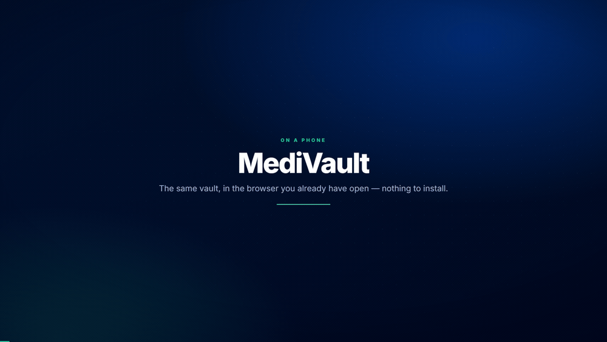
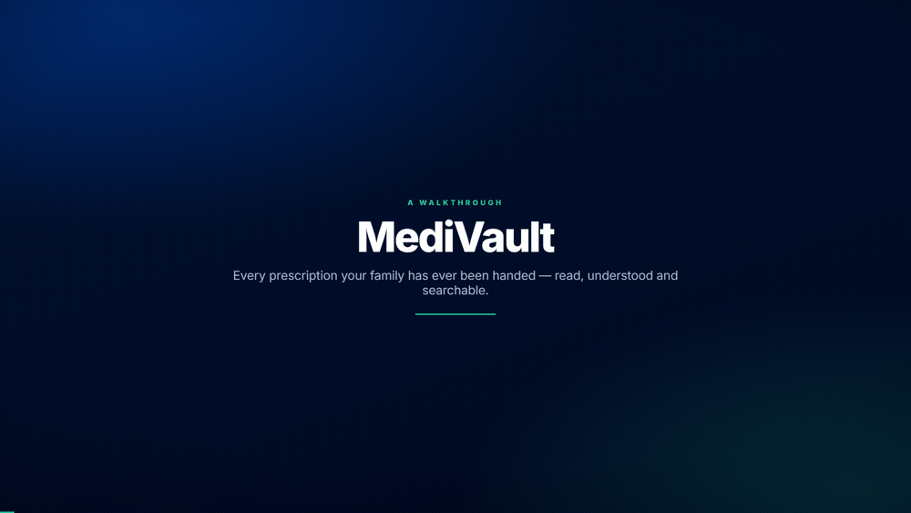
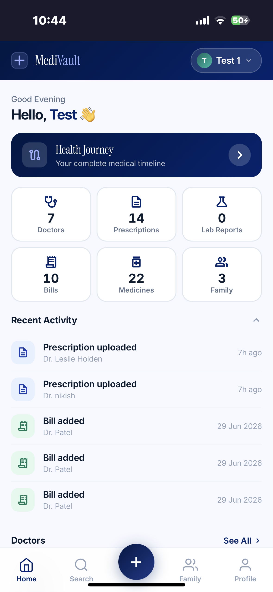
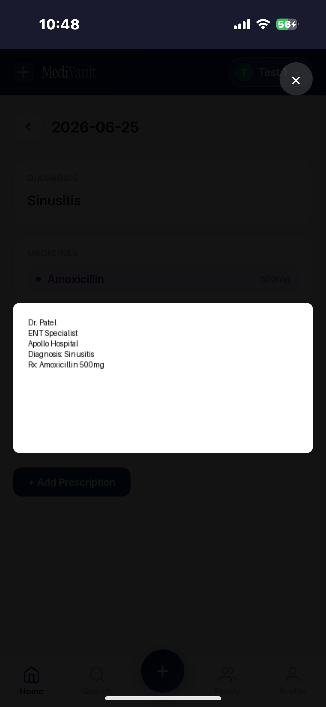
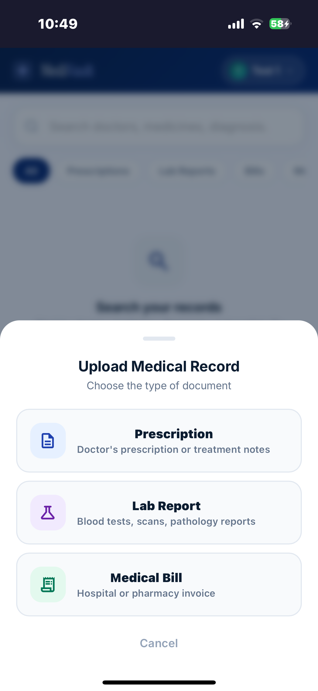

<h1 align="center">MediVault</h1>

<p align="center">
  <strong>AI-powered family medical records</strong><br/>
  Photograph any prescription, printed or handwritten. It reads the page, pulls out the
  doctor, the diagnosis and every medicine, and files it under the visit it belongs to.
</p>

<p align="center">
  <a href="https://mymedivault.vercel.app/"><strong>Live demo</strong></a> ·
  <a href="#watch-it-work">Walkthrough</a> ·
  <a href="#running-it-locally">Run it locally</a>
</p>

<p align="center">
  <a href="https://github.com/Afkar085/MediVault/actions/workflows/ci.yml"></a>
  
  
  
</p>

---

## Watch it work

Narrated, at both sizes. Every frame of the app is a real screenshot of it running —
not a mockup. The GIFs here are silent previews; the MP4s carry the voiceover.

### On a phone browser



<sub>**[Full 76-second walkthrough → `docs/walkthrough-phone.mp4`](docs/walkthrough-phone.mp4)**</sub>

### On a desktop



<sub>**[Full 77-second walkthrough → `docs/walkthrough.mp4`](docs/walkthrough.mp4)**</sub>

Both cover the same ground: a handwritten prescription uploaded and read, the record it
produced down to each medicine's dose, the visit timeline, a second family member, search,
and what happens when a page cannot be read.
[`scripts/walkthrough/`](scripts/walkthrough) is the pipeline that generates them, so they
can be rebuilt when the UI changes instead of going stale.

---

## The problem

A family's medical history lives in a drawer: loose prescriptions, lab reports stapled to
bills, handwriting nobody can read two years later. The useful question — *what did the
cardiologist put Dad on, and when?* — takes twenty minutes of paper-shuffling to answer.

MediVault takes a photograph of the page and turns it into a record you can search.

---

## Features

**Reading documents**

- Handles handwritten and printed prescriptions, lab reports, bills and discharge summaries
- Extracts doctor, hospital, specialty, diagnosis, advice, and each medicine with its dose,
  schedule and duration
- Any photo or PDF. Files are validated on the device, so an unsupported or oversized file
  is refused immediately rather than after a long upload
- A page it cannot read says so and explains what to try, instead of sitting on
  *Processing* forever — and your original is kept either way

**Organising them**

- Records are grouped into doctor visits automatically. A prescription, a lab report and
  several bills from one visit stay together even when uploaded weeks apart
- Per-bill category, number and amount, with an insurance-claimed toggle and a running
  claimed/unclaimed total per visit
- Each family member gets an independent timeline. Records are never shown under the wrong
  name, even when you switch faster than the network responds
- Every field change is logged, old value → new value, with a timestamp

**Finding them again**

- **Find** ranks across doctor, hospital, department, diagnosis, medicines, the scanned
  text and dates (`June`, `2026`) — one member or the whole family, each result labelled
  by owner
- **Ask** answers plain questions (*"What did Dad take for his knee?"*, *"What was my
  haemoglobin?"*) grounded in the documents themselves, not only the extracted columns, so
  a lab value that was never extracted into a field can still be quoted back
- Every answer lists the records it used; each citation shows its excerpt and opens that
  record, including when it belongs to a different family member
- It never diagnoses, never suggests changing treatment, and says so plainly when the
  records do not contain the answer rather than guessing
- Semantic matching uses pgvector when the embedding model is available and falls back to
  term-overlap ranking when it is not. The feature does not disappear on a small host — the
  matching just becomes literal

**Details that matter**

- Every row and control is keyboard-reachable with visible focus. Overlays are real
  dialogs: focus moves in, Tab stays inside, Escape closes, focus returns to the opener
- Pinch-zoom works, because the documents are photographs and small print matters
- Verified from 320px to 1920px, with fingertip-sized touch targets
- A free-tier backend sleeps when idle; reads are retried patiently and the app says what
  is happening instead of reporting itself broken

**Security**

- Documents are served only through short-lived signed URLs generated per request. No
  public URL is stored anywhere, and storage keys come from the verified file type, never
  the uploaded filename
- Upload validation reads the actual bytes, not the claimed content type
- Rate limits on every endpoint that issues credentials or calls a model; restricted CORS
  and HSTS, CSP and X-Frame-Options on every response
- Startup refuses a `JWT_SECRET` under 32 characters
- The AI reaches data only through tools bound to the signed-in user's own profiles. No
  tool takes a user id, runs SQL, or can widen its own scope
- Account deletion cascades through every family profile and document

---

## How it works

```
Upload photo or PDF
        │
        ▼
Groq Vision (Qwen3.6 27B) reads raw text from the page
handwriting, stamps, mixed formats; pages read concurrently
        │
        ▼
A second pass (gpt-oss-120b) extracts structured fields
doctor · hospital · date · specialty · diagnosis · advice · medicines
        │
        ▼
Record saved, grouped into its visit, and shown
when uploading inside a visit the date is enforced post-OCR,
so the document cannot drift into the wrong one
```

```
React 19 (Vercel)
    │  HTTPS + JWT
FastAPI (Render)
    │  background OCR tasks
    ├── Groq Vision        →  raw text
    └── Groq gpt-oss-120b  →  structured data, summaries, tool-calling answers
    │
Supabase (PostgreSQL + private Storage)
    ├── records            →  extracted fields + optional embedding
    └── document_passages  →  document text, chunked, optionally embedded
```

The design is one typeface (Inter), a navy brand band, and white grouped surfaces on a soft
background. Colour is reserved for meaning — document-type tints and record status. Records
look identical everywhere they appear, a record is one scrolling page, and adding one is a
single sheet.

---

## Screenshots

<table>
  <tr>
    <td width="33%"></td>
    <td width="33%"></td>
    <td width="33%"></td>
  </tr>
  <tr>
    <td align="center">Dashboard</td>
    <td align="center">Record details</td>
    <td align="center">Upload</td>
  </tr>
</table>

---

## Running it locally

### Without any credentials — recommended

`backend/scripts/dev_server.py` runs the real API against an in-memory database and storage
with a deterministic stand-in for the OCR and language models, so the whole app works
without a Supabase project or a Groq quota. It never reads your `.env`, and data is lost on
restart.

```bash
git clone https://github.com/Afkar085/MediVault.git && cd MediVault

cd backend && python scripts/dev_server.py        # API on http://localhost:8787
```

```bash
cd frontend && npm install
echo REACT_APP_API_URL=http://localhost:8787/api/v1 > .env.local
npm start                                          # app on http://localhost:3000
```

Sign in with the dev account named at the top of `dev_server.py`. A second family member
and a document that failed OCR are seeded. `scripts/make_dev_documents.py` writes readable
and unreadable test documents to upload, `GET /__dev/stats` reports query and model-call
counts, and `POST /__dev/models?fail=true` simulates the model service being down.

### Against real services

```bash
cd backend
python -m venv .venv && .venv/Scripts/activate    # macOS/Linux: source .venv/bin/activate
pip install -r requirements-dev.txt
cp .env.example .env                               # then fill it in
uvicorn app.main:app --reload
```

`backend/.env.example` lists every required variable. `JWT_SECRET` must be at least 32
characters or the app refuses to start:

```bash
python -c "import secrets; print(secrets.token_urlsafe(48))"
```

Point the frontend at `http://localhost:8000/api/v1` instead.

The database needs `backend/database/schema.sql` for a new project, or every file in
`backend/database/migrations/` in order for an existing one, run from the Supabase SQL
editor. **Migration 007 is required**: it creates the `refresh_tokens` table that keeps
people signed in. Until it is applied the app still works, but sessions fall back to a
single 24-hour access token with no renewal, which is what they were before.

### Tests

```bash
cd backend  && ruff check app tests && pytest -q                    # 282 tests
cd frontend && CI=true npm test -- --watchAll=false && CI=true npm run build
```

Both run in CI on every push; the frontend build treats lint warnings as errors.
`scripts/e2e-journeys.mjs` clicks through the 17 core journeys in headless Chrome against
the dev stack. `scripts/measure.py` reports what each hot request costs the server
(queries, writes, signed-URL round-trips) against the same dev stack.

---

## Tech stack

| Layer | Technology |
|---|---|
| Frontend | React 19, custom CSS — no UI library |
| Backend | FastAPI, Pydantic v2 |
| Database | PostgreSQL via Supabase |
| File storage | Supabase Storage — private bucket, signed URLs |
| OCR | Groq, `qwen/qwen3.6-27b` (vision) |
| Extraction, summaries, answers | Groq, `openai/gpt-oss-120b` (via `GROQ_TEXT_MODEL`) |
| Retrieval | Document passages + pgvector (optional), fused with keyword ranking via RRF |
| Auth | JWT + bcrypt |
| Tests | pytest + ruff, Jest + Testing Library, GitHub Actions |
| Hosting | Vercel (frontend), Render (backend) |

---

<p align="center">
  Built by <a href="https://github.com/Afkar085">Afkar</a> ·
  <a href="https://mymedivault.vercel.app/">Try it live</a>
</p>
